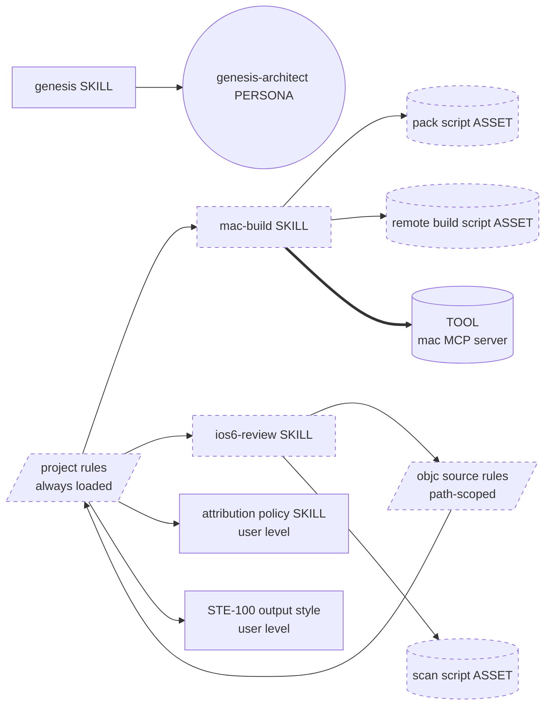
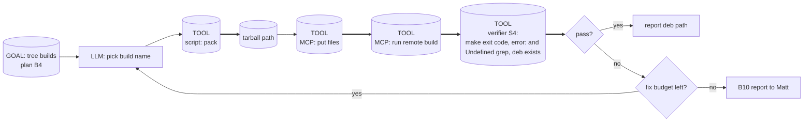
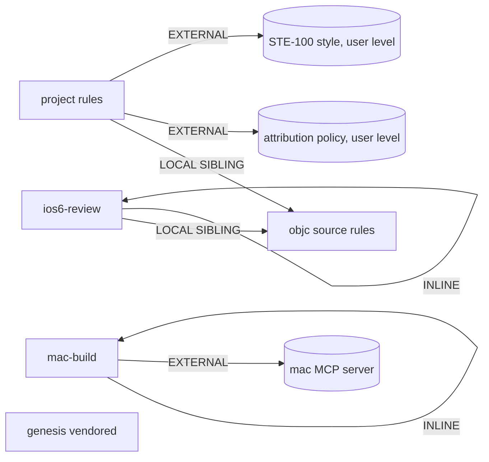

# Agent tooling for LegacyPodClaw: genesis handoff packet

Design process: `.claude/skills/genesis` (vendored at the commit in
`.claude/skills/genesis/VERSION`). This file is the step-6 handoff
packet and the plan store. Reload it before you change any module it
lists. Re-run genesis from this file, not from the emitted modules.

## 1. Intent and scope (step 1)

Agents that work on this repo make the same mistakes again and again.
They use iOS 7+ APIs, they write ARC-style code, they send HTTPS
through `NSURLConnection`, they put secrets in the prefs plist, they
call tools around `OCToolDispatcher`, they break Logos output with
`%orig; return;` on one line, and they try to build on Linux. The
tooling gives each agent the hard constraints at the moment it needs
them, a deterministic way to build on the Mac mini, and a
deterministic first pass of an iOS 6 compatibility review.

The capability statement has three parts. Single Responsibility splits
it into three designs that share one rule source:

| Design | Capability | Not in scope |
|---|---|---|
| D1 project rules | State the target, the invariants and the house rules | Build steps, review procedure |
| D2 mac-build | Compile and package the tree on the Mac mini; report errors | Install on a device, release, publish |
| D3 ios6-review | Check changed Objective-C / Logos code against the iOS 6 rules | General code review, style, security audit |

Rejected: a device-test checklist. No R1 trigger fires and agents have
no device access, so a checklist module would be dead weight
(PREMATURE SPLIT). Revisit when an agent can reach the device.

Rejected: a commit-attribution hook. The user-level `no-claude-help`
plugin already owns that policy (SoC: depend, do not duplicate).
CLAUDE.md only names the rule.

Cost stance: `balanced` (default; Matt declared none). Cost cap: none.

Invocation mode: both skills are BOTH (discovery and `/name`).

## 2. Component diagram (step 2)



Types: RULE = project rules, objc source rules. SKILL = mac-build,
ios6-review, genesis. ASSET = scripts. PERSONA = genesis-architect.
The mac MCP server already exists; this design does not author it.

Refactor pass (tier order, step 1) over the existing graph:

- R3 EXTRACT fired on the brief: the iOS 6 code rules were going to sit
  in both CLAUDE.md and the reviewer. They now live in one path-scoped
  rule (S6 RULE BRIDGE). The reviewer depends on it; CLAUDE.md links
  to it.
- R1 SPLIT did not fire on mac-build (one trigger verb: build).
- R2 FUSE checked mac-build against ios6-review: different lenses, not
  invoked in lockstep. No fusion.
- R4 INLINE: no reviewer persona file. A persona that only loads the
  skill is a thin proxy; the skill runs in a forked thread on its own.

## 3. Thread / sequence diagram (step 3)

Tier-3 selection:

- mac-build = A9 SUPERVISED EXECUTION, weak form (this surface has no
  capability gating). Side effect: files written and compiled on the
  Mac. Fact that must be true: "the tree builds".
- ios6-review = S4 VALIDATION DECORATOR, realised as one fresh-context
  reviewer thread (C3 THREAD SPAWN) with an S7 deterministic scan in
  front. Not A1 PANEL: the lens-count gate (3 or more independent
  lenses) did not fire; the rule set is one rubric.
- B4 PLAN MEMENTO = this file. B8 ATTENTION ANCHOR = CLAUDE.md (in the
  cached prefix of every session) plus the path-scoped rule (injected
  again when a source file is touched).

```mermaid
sequenceDiagram
    participant Main as main thread
    participant Rev as ios6-review thread (fresh ctx)
    participant Sh as local shell
    participant Mac as mac MCP server
    Note over Main: CLAUDE.md in prefix; objc rule loads on first source edit
    Main->>Rev: spawn (diff base ref)
    Rev->>Sh: scan script over diff
    Sh-->>Rev: JSON findings
    Rev-->>Main: JSON receipt (findings + verdict)
    Note over Main: main thread is the only writer to the tree
    Main->>Sh: pack script (name)
    Sh-->>Main: tarball path
    Main->>Mac: mkdir, put tarball, put remote script
    Main->>Mac: run remote build script
    Mac-->>Main: JSON (status, errors, undefined, deb)
    Note over Main: verdict comes from the script result, not from recall
```

A9 flow for mac-build:



No B10 checkpoint before the build: the effect is reversible and stays
in a per-name scratch directory. The remote script refuses a name that
would resolve to the shared `~/lpc-build` directory.

### Step 3.1 tradeoff check

Two patterns fit the reviewer slot: A7 ADVERSARIAL REVIEW and S4
VALIDATION DECORATOR. Matrix #2 (gate types) cuts it: the failure mode
is a rule violation that a programmatic scan plus a rubric can catch
(INTERNAL x PROGRAMMATIC = S4), not goal drift or cold-reader clarity.
Chosen: S4 with an S7 scan. Fresh context stays, because the producer
thread is biased toward its own code.

```
%% tradeoff: matrix #2 gate types -> INTERNAL x PROGRAMMATIC (S4) row
%% tradeoff: matrix #9 execution doctrine -> rows 1, 2, 4 (tool-delegated build, facts, verify)
```

### Step 3.2 cost check

| Module | Role class | Prefix size | Output volume | Cost patterns applied | Cost-shape matrix row |
|---|---|---|---|---|---|
| project rules | (prefix only) | S (< 2K) | none | B13: no dates, no volatile text | #10 "Long-running session, mostly read-only" -> B13 |
| objc source rules | (prefix only) | S (< 2K) | none | B13; loads lazily by path | same row |
| mac-build | implementer (inherit main model) | S | S (script filters the log) | S7 in place of LLM log reading | #10 "Long synthesis output" -> S7 |
| ios6-review | reviewer | S-M | S (JSON receipt) | B12 route to reviewer class; S7 scan | #10 "Single-turn classification or extraction" -> B12 |

## 3.5 Composition decision and dependency graph

| Box | Mode | Rationale |
|---|---|---|
| project rules | INLINE (one file) | Unique to this repo |
| objc source rules | LOCAL SIBLING | Used by the reviewer and by every source edit |
| mac-build scripts | INLINE assets of the skill | Only mac-build uses them |
| ios6-review scan | INLINE asset of the skill | Only ios6-review uses it |
| genesis | LOCAL SIBLING (vendored copy) | Pinned by commit hash in VERSION; no module system in this repo |
| attribution policy, STE-100 | EXTERNAL (user level, installed) | User config scope; not shipped with the repo |
| mac MCP server | EXTERNAL tool | Matt's infrastructure |



External modules that a module-system adapter must resolve: none. The
user-level items and the MCP server are declared by a companion note in
the body plus a tool-call probe at the use site (mac-build calls the mac
status tool first). The repo has no manifest, so step 7b loads no
module-system adapter.

Audience per artifact:

| Artifact | Audience | Mode |
|---|---|---|
| CLAUDE.md, rule file, skill bodies | INTERNAL, also read by Matt | STE prose (Matt's rule overrides caveman) |
| scan and build script output | INTERNAL | JSON |
| ios6-review receipt | INTERNAL | JSON |
| report to Matt, PR body, commits | EXTERNAL | STE prose |

## 4. SoC pass

- Installed user-level skills that can collide: `review`, `code-review`,
  `security-review` (against ios6-review); `deploy`, `ci` (against
  mac-build). Both new descriptions name LegacyPodClaw, iOS 6 or the
  Mac mini and state the boundary. Collision risk after narrowing: LOW.
- `operate-pi` uses the Mac mini only as an SSH jump host. No overlap.
- Every consequential step crosses S7: pack (script), put and run
  (MCP), verify (script exit code and grep), scan (script). No step
  leaves a fact to recall.

## 5. Compliance check

| Check | Result |
|---|---|
| SoC / SRP | pass: one capability per module |
| Composition | pass: rules held once, linked |
| One writer | pass: only the main thread edits the tree; the reviewer is read-only |
| PROSE progressive disclosure | pass: objc rule loads by path; scripts load lazily |
| PROSE reduced scope | pass: reviewer runs in a fresh thread |
| PROSE safety boundaries | pass: build in a per-name dir; name validated |
| Skill `name` regex = dir name | checked at step 8 |
| Body <= 500 lines and <= 5000 tokens | checked at step 8 |
| ASCII only | checked at step 8 |

Open findings:

- MEDIUM: the scan is a heuristic grep. It catches the known traps; the
  rubric pass catches the rest. Accepted.
- LOW: the genesis Claude Code adapter is out of date (see the
  validation record).

## 6. Interface sketch

| Module | Path | Trigger | Inputs | Outputs | Depends on |
|---|---|---|---|---|---|
| project rules | `CLAUDE.md` | always loaded | none | none | `.claude/rules/objc-ios6.md`, the two skills |
| objc source rules | `.claude/rules/objc-ios6.md` | path match on `.m`, `.h`, `.xm`, `Makefile` | none | none | `CLAUDE.md` |
| mac-build | `.claude/skills/mac-build/SKILL.md` | discovery, or `/mac-build [name]` | build name | JSON result; .deb path on the Mac | `scripts/pack.sh`, `scripts/remote-build.sh`, mac MCP tools |
| ios6-review | `.claude/skills/ios6-review/SKILL.md` | discovery, or `/ios6-review [base]`; forked thread | base ref | JSON receipt | `scripts/scan.sh`, `.claude/rules/objc-ios6.md` |

Declared targets: Claude Code only.
Reason: the build path depends on the mac MCP tools in Claude Code;
path-scoped rules and forked skills are Claude Code affordances; Matt
uses no other harness on this repo.

## PER-SPAWN DECLARATION TABLE

| Spawn # | Role/Lens | Audience | Tier | Brief mode | Receipt mode | Justification |
|---|---|---|---|---|---|---|
| 1 | ios6 compatibility reviewer | INTERNAL | REVIEWER | CAVEMAN_LITE (as STE) | JSON_RECEIPT | fixed rubric; Matt requires STE in place of caveman |

## SPAWN_BRIEF #1

The ios6-review skill body is the brief. Argument: the base ref.

## RECEIPT_SCHEMA #1

```json
{"verdict":"pass|fail","range":"<base>..HEAD","findings":[{"sev":"blocker|high|medium|low","rule":"<rule id>","file":"<path>","line":0,"fix":"<one STE sentence>"}],"notes":"<one line or empty>"}
```

## HUMAN_RATIONALE (never copied into a spawn brief)

The main pain is repeat mistakes, not missing knowledge. The cheapest
cure puts each constraint where the agent sees it at the moment of the
mistake: invariants in the always-loaded file, code-level traps in a
rule that loads when a source file is touched, and two deterministic
scripts that turn "did it build" and "did I use an iOS 7 API" into tool
output in place of recall. A reviewer persona, a device checklist and
a hook were each considered and dropped. Each adds a dispatcher entry
and upkeep, and no trigger justifies them.

## 7. Evals plan

Content evals (run with and without the skill):

1. ios6-review: a diff that adds `dateByAddingUnit:`, an HTTPS
   `NSURLConnection` call and `if (x) { %orig; return; }` in a `.xm`.
   Expected: three findings with the right rule ids.
2. ios6-review: a clean diff (comment change only). Expected: pass,
   zero findings.
3. mac-build: build this branch. Expected: status ok and a .deb path,
   or a list of `error:` lines.

Trigger evals: `.claude/evals/agent-tooling.json` holds should-trigger
and near-miss queries per skill, split 60/40 train/val.

## 8. Cost projection

Stance: `balanced`. Cap: none. Pricing source: the genesis Claude Code
adapter footnote, "verified on 2025-11-14". That date is old; verify
again before you quote a figure.

Per-module bands: the step 3.2 table. The bands are the contract.

One representative run, Sonnet-class rates, mostly cached prefix:

| Scenario | Work | Input tokens | Output tokens | Turns | USD |
|---|---|---|---|---|---|
| S | one-file fix, review + build | 60K-120K | 2K-5K | 8-14 | 0.05-0.30 |
| M | feature in one framework | 150K-400K | 5K-15K | 15-40 | 0.15-0.90 |
| L | repo-wide change | 0.5M-2M | 15K-60K | 40-120 | 0.50-4.00 |

Cited patterns: B13, B12, S7 in place of long output (matrix #10 rows
named in the step 3.2 table). Cap check: no cap declared.

## 9. Todo list

1. vendor genesis, LICENSE, NOTICE, VERSION
2. write this packet
3. `.claude/rules/objc-ios6.md` (after 2)
4. `CLAUDE.md` (after 3)
5. mac-build skill and scripts (after 2)
6. ios6-review skill and scan script (after 3)
7. evals file (after 5 and 6)
8. step 8 validation (after 3 to 7)

## 10. Step 8 validation record

Structural lint:

| Check | Result |
|---|---|
| Interface sketch matches modules | pass |
| `name` regex and dir name (mac-build, ios6-review) | pass |
| Description length (cap 1024) | pass: 476 and 648 characters |
| Body size (cap 500 lines / 5000 tokens) | pass: 91 and 78 lines |
| ASCII only (all new files) | pass |
| Declared target in each module header | pass: Claude Code, with reason |
| Scripts: non-interactive, `--help`, JSON on stdout, diagnostics on stderr | pass; shellcheck clean at warning level |
| Rubric held once (no copy in skill bodies) | pass |
| Cost: role classes as projected, no dates or volatile text in prefix files | pass |
| Audience: one spawn row, JSON receipt, STE brief | pass |

Real-task refinement:

1. mac-build, run 1 on this branch: `status: fail`, `make_exit: 2`, empty
   `errors`. Cause: `ldid: command not found` in a non-login ssh shell.
   Change: the remote script now puts `/usr/local/bin` and
   `/opt/homebrew/bin` on PATH, checks for `ldid` first, and returns
   `tail` on a failure; the skill now tells the agent how to read
   `tail`. Without `tail` the agent had no evidence and had to read the
   log by hand.
2. mac-build, run 2 (non-login shell on purpose): `status: ok`, .deb
   `pro.matthesketh.legacypodclaw_0.3.0_iphoneos-arm.deb`.
3. scan `--all` on the current tree: 48 findings. 2 real blockers
   (`dateByAddingUnit:` in `Frameworks/Providers/ProviderRegistry.m`
   lines 416 and 420), 1 false positive (`NSURLSession` inside a string
   literal in `SkillRegistry.m`), 45 `NSURLConnection` uses (see the
   pre-existing defects below).

Content eval 1 (ios6-review-traps, 10 planted problems: weak property,
HTTPS through NSURLConnection, secret in prefs, direct tool handler
call, dateByAddingUnit:, NSCalendarUnitDay, containsString:, leaked
alloc, Logos one-line return, file not in a Makefile):

- with skill: 10 findings; all 9 code problems found with the correct
  rule ids, plus the missing secret key in both lists. The Makefile
  case was noted and dismissed on purpose (temporary eval files).
- without skill (same model, same files, generic iOS 6 prompt): 7
  findings. It missed the direct tool handler call and the Logos
  one-line `%orig; return;` trap, rated the secret in prefs `low`, and
  did not see the key-list gap. It did find one thing the skill run
  did not: `CPDeviceIsLocked` is static in `Tweak.xm`, so the eval
  `.xm` would not compile. The build gate (mac-build) catches that
  class of error, so no change to the skill.
- Delta: the skill adds the project invariants (dispatch, secrets,
  Logos) that a generic reviewer does not know. The skill adds value;
  keep it.

Trigger evals: written, not run. Claude Code has no batch trigger-eval
runner; run them by hand or with the `skill-creator` tooling.

Where genesis did not fit Claude Code (checked against
code.claude.com docs for v2.1.303):

- The vendored Claude Code adapter says there are no glob-scoped rules.
  Claude Code has `.claude/rules/*.md` with `paths:` frontmatter. This
  design uses it.
- The adapter lists stale fields (`instructions`, `allowed_tools`,
  `allowed_models`), the old "Task tool" name and an old default model.
  Real fields: `allowed-tools`, `context: fork`, `agent`, `model`,
  `paths`; subagents take `tools`, `skills`, `model`.
- `agents/genesis-architect.agent.md` sits inside the skill folder.
  Claude Code loads subagents only from `.claude/agents/`, so the
  persona is a linked text file, not a spawnable agent.
- The persona file repeats its anti-pattern list two times.
- Genesis assumes a `task()` spawn tool and caveman briefs. Here the
  spawn is a forked skill, and Matt's STE rule replaces caveman.
- The evals gate expects a trigger-eval runner. Claude Code has none
  built in.
- Pricing in the adapter is dated 2025-11-14.
- The `no-claude-help` attribution scan rejects one upstream line in
  `assets/runtime-affordances/per-harness/claude-code.md`. That line
  now ends with an `nch-allow` marker. It is the only local change to
  the vendored copy.

Pre-existing defects found during design (not fixed here; source code
is out of scope for this change):

- `Frameworks/Providers/ProviderRegistry.m:416,420` calls
  `dateByAddingUnit:value:toDate:options:` (iOS 8+). The cron next-fire
  path crashes on iOS 6. The loop also runs up to 527040 times.
- HTTPS still goes through `NSURLConnection` in `Agent.m`,
  `ProviderRegistry.m`, `DiscordChannel.m`, `SlackChannel.m`,
  `WebhookChannel.m`, `MediaPipeline.m`, `ExtendedTools.m` and
  `MusicDownloader.m`. This breaks invariant 1.
- `BUILD.md` is stale: it names `openclaw-ios6`, the old `OC*` framework
  folders and a `1.0.0` package.
- The Mac build links `libroot.a` built for iOS 7.0 (ld warning
  "built for newer iOS version (7.0) than being linked (6.0)"). Check
  that this code does not run on iOS 6.
